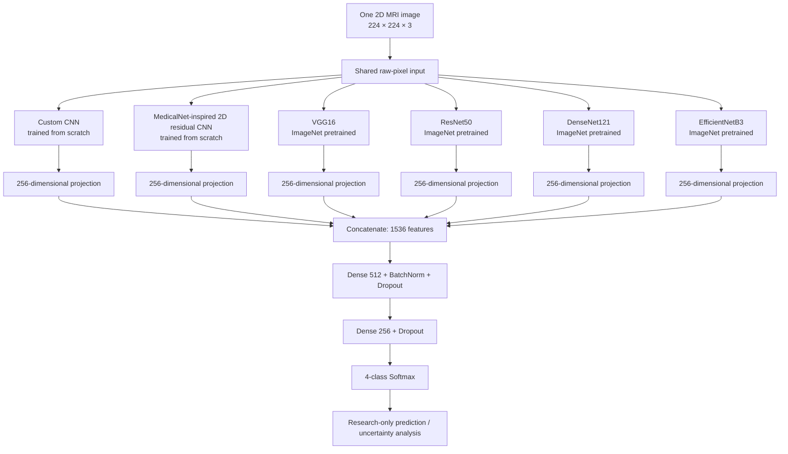

<div align="center">

# NeuroFusion-MRI

### An Explainable, Reliability-Aware Hybrid Deep Learning Framework for Brain Tumor MRI Classification

**Six-branch feature fusion · MRI classification · Leakage auditing · Domain robustness · Uncertainty estimation · Explainability · Knowledge distillation**


**[Overview](#overview) · [Architecture](#system-architecture) · [Getting Started](#getting-started) · [Results](#experimental-results) · [Limitations](#limitations-and-responsible-use) · [Research Roadmap](#research-roadmap)**

</div>

> [!IMPORTANT]
> **Research and educational use only.** This project is **not a medical device**, is **not clinically validated**, and must **not** be used to diagnose brain tumors, rule out disease, triage real patients, recommend treatment, or replace a radiologist. All reported numbers are **recorded notebook results**, not independent reproduction by this repository's README author.

> [!WARNING]
> **The headline test accuracy is not a trustworthy estimate of real-world generalization.** A perceptual-hash audit flagged **1,390/1,600 (86.9%)** test images as near matches to training/validation images. On the **210 unflagged test images**, the original hybrid's recorded accuracy was **73.33%**, versus **91.69%** on all 1,600. These are *hash-based flags*, not manually verified same-patient duplicates; the unflagged subset is not guaranteed independent at the patient or institution level. See [Data integrity and leakage](#data-integrity-and-leakage-audit).

---

## Table of Contents

1. [Overview](#overview)
2. [Research objectives and problem statement](#research-objectives-and-problem-statement)
3. [Capabilities and implementation status](#capabilities-and-implementation-status)
4. [System architecture](#system-architecture)
5. [Dataset and data structure](#dataset-and-data-structure)
6. [Software requirements](#software-requirements)
7. [Getting started](#getting-started)
8. [How to run and reproduce each experiment](#how-to-run-and-reproduce-each-experiment)
9. [Image preprocessing and augmentation](#image-preprocessing-and-augmentation)
10. [Model architecture and training](#model-architecture-and-training)
11. [Evaluation metrics](#evaluation-metrics)
12. [Experimental results](#experimental-results)
13. [Data integrity and leakage audit](#data-integrity-and-leakage-audit)
14. [Domain shift and robustness](#domain-shift-and-robustness)
15. [Calibration, uncertainty, and referral policies](#calibration-uncertainty-and-referral-policies)
16. [Grad-CAM and explainability](#grad-cam-and-explainability)
17. [Knowledge distillation and deployment experiments](#knowledge-distillation-and-deployment-experiments)
18. [Patient-level, 3D, and multimodal extensions](#patient-level-3d-and-multimodal-extensions)
19. [DICOM, auditing, and drift monitoring](#dicom-auditing-and-drift-monitoring)
20. [Saved files and repository layout](#saved-files-and-repository-layout)
21. [Single-image inference](#single-image-inference)
22. [Troubleshooting and frequently asked questions](#troubleshooting-and-frequently-asked-questions)
23. [Limitations and responsible use](#limitations-and-responsible-use)
24. [Research roadmap](#research-roadmap)
25. [Reproducibility checklist](#reproducibility-checklist)
26. [Acknowledgments, attribution, and license](#acknowledgments-attribution-and-license)

---

## Overview

**NeuroFusion-MRI** is an experimental machine-learning workflow for classifying **individual 2D brain MRI images** into four classes:

| Class label | Meaning in this dataset |
|---|---|
| `glioma` | Image labeled as glioma |
| `meningioma` | Image labeled as meningioma |
| `notumor` | Image labeled as no tumor |
| `pituitary` | Image labeled as pituitary tumor |

The primary approach is a **feature-level hybrid deep learning model** that sends the same RGB-formatted MRI slice through six feature-extraction branches and concatenates their learned representations before classification. A companion set of experiments evaluates the pipeline's weaknesses and investigates possible improvements in robustness, confidence estimation, explanation fidelity, compute efficiency, and clinical-workflow readiness.

The repository is based on the uploaded Kaggle notebook **`brain-tumor-gap-solutions.ipynb`**. That notebook combines an initial hybrid classification workflow (sections 1–18) with a research-gap analysis and experimental extensions (sections 19–25). The latter **depends on models, arrays, splits, and predictions created by the former**.

**This is not brain-tumor segmentation.** It does not delineate tumor boundaries, calculate 3D tumor volume, identify tumor grade, or make an individual patient diagnosis. Its main measured task is **four-class, 2D image classification**.

### What makes the study useful?

- A comparative study of **multi-branch feature fusion** versus individually trained CNN backbones and a weighted soft-voting ensemble.
- A **data-leakage investigation** that materially changes interpretation of apparent model accuracy.
- A synthetic acquisition-shift stress test and **robustness fine-tuning** experiment.
- **Temperature scaling**, confidence calibration, ensemble disagreement, abstention/referral, and conformal-set experiments.
- An assessment of **Grad-CAM explanation fidelity**, including negative results.
- **EfficientNet-B0 student distillation**, TensorFlow Lite conversion, file-size and CPU-latency comparison.
- Code scaffolding for later studies with **patient IDs, multiple MRI sequences, 3D volumes, DICOM, and audit logs**.

### Non-goals

The current dataset and notebook **do not support valid claims** of multi-center clinical generalization, patient-level accuracy, biopsy-confirmed histological diagnosis, age/sex/scanner fairness, rare-tumor recognition, or regulatory compliance.

---

## Research objectives and problem statement

**Problem:** A high four-class classification score on a public MRI image collection may hide repeated or augmented images, image-size shortcuts, scanner/protocol sensitivity, poor calibration, explanation failures, and deployment constraints. Single-image predictions are also not equivalent to patient-level assessment.

The notebook investigates six practical questions:

1. Do complementary CNN branches improve classification relative to individual baselines?
2. Does train/validation/test overlap inflate evaluation results?
3. How fragile are predictions under contrast, noise, blur, resolution, and bias-field perturbations?
4. Can confidence calibration and selective prediction identify cases that should be deferred?
5. Are generated explanation heatmaps more faithful than random feature removal?
6. Can a smaller student model reduce compute requirements without unacceptable quality loss?

The companion code additionally outlines paths toward patient-level aggregation, multi-sequence 3D modeling, basic DICOM intake, monitoring, and clinical research governance.

---

## Capabilities and implementation status

| Component | In the notebook? | What has actually been evaluated? |
|---|---|---|
| Four-class 2D MRI classifier | Yes | Test classification report, confusion matrix, ROC-AUC |
| Six-branch feature fusion | Yes | Trained with a two-phase schedule |
| Six standalone baseline models | Yes | Test accuracy for each |
| Weighted soft voting | Yes | Test accuracy and class report |
| Exact/perceptual duplicate audit | Yes | Train/val/test hash screening |
| Pseudo-domain diagnostic | Yes | Leave-one-pseudo-domain-out on frozen DenseNet features with a linear classifier |
| Synthetic corruption stress tests | Yes | Before and after robust fine-tuning |
| Temperature scaling | Yes | NLL, Brier score, expected calibration error |
| Ensemble-based uncertainty | Yes | Error-detection AUROC |
| Confidence-based deferral | Yes | Retrospective simulation on the test images |
| Conformal prediction sets | Yes | Coverage measured; **did not reach target** |
| Corrected DenseNet-branch Grad-CAM | Yes | Deletion faithfulness check; **weak result** |
| Knowledge-distilled EfficientNet-B0 | Yes | Student accuracy, estimated size, CPU latency |
| Dynamic-range-quantized TFLite export | Yes | Limited 400-image accuracy comparison |
| Patient aggregation and attention MIL | Prototype | Functional code/smoke test, **not real patient validation** |
| Four-sequence 3D classifier | Prototype | Random-data smoke test, **not a trained clinical model** |
| DICOM adapter | Basic utility | **No end-to-end hospital integration** |
| Shadow-mode log and drift monitor | Demo | Uses retrospective test examples, **not a prospective study** |

---

## System architecture



The architecture above is the **actual 2D hybrid**. It does **not** load pretrained 3D MedicalNet/Med3D weights. The “MedicalNet-inspired” branch is a **custom 2D residual CNN**, named for design inspiration rather than for direct reuse of pretrained MedicalNet weights.

### Feature-level fusion versus soft voting

**Feature fusion (primary hybrid):**

\[
\mathbf{z} = [\mathbf{f}_1;\mathbf{f}_2;\ldots;\mathbf{f}_6],\quad \mathbf{f}_i \in \mathbb{R}^{256},\quad \mathbf{z} \in \mathbb{R}^{1536}
\]

The fused representation is passed through trainable dense layers to produce one classification probability vector.

**Weighted soft voting (baseline alternative):**

\[
P(y\mid x) = \sum_{i=1}^{6} w_i P_i(y\mid x), \qquad
w_i = \frac{a_i^{\mathrm{val}}}{\sum_j a_j^{\mathrm{val}}}
\]

where \(a_i^{\mathrm{val}}\) is the individual model's validation accuracy. It combines **predictions**, not intermediate features, and does not have the same fusion head.

---

## Dataset and data structure

**Dataset in the notebook:** Masoud Nickparvar's *Brain Tumor MRI Dataset*, obtained through Kaggle.

- Kaggle dataset identifier: `masoudnickparvar/brain-tumor-mri-dataset`
- Dataset page: https://www.kaggle.com/datasets/masoudnickparvar/brain-tumor-mri-dataset
- Notebook path convention: `/kaggle/input/datasets/masoudnickparvar/brain-tumor-mri-dataset/`
- Images are organized by class in `Training/` and `Testing/` folders.
- Four classes are derived by sorting the training folder's directory names.

```text
brain-tumor-mri-dataset/
├── Training/
│   ├── glioma/
│   │   └── *.jpg
│   ├── meningioma/
│   │   └── *.jpg
│   ├── notumor/
│   │   └── *.jpg
│   └── pituitary/
│       └── *.jpg
└── Testing/
    ├── glioma/
    │   └── *.jpg
    ├── meningioma/
    │   └── *.jpg
    ├── notumor/
    │   └── *.jpg
    └── pituitary/
        └── *.jpg
```

### Recorded split

The notebook uses a **15% stratified image-level validation split** carved from `Training/`, with the supplied `Testing/` folder as test data. Its saved execution reports:

| Split | Images | Construction |
|---|---:|---|
| Training | 4,760 | From dataset `Training/`, excluding the validation portion |
| Validation | 840 | Stratified 15% of original training images |
| Test | 1,600 | Dataset `Testing/` folder; 400 images per class |
| **Total** | **7,200** | Image count, **not independent patient count** |

**Important:** These are image-level splits; **patient IDs and scanner/site metadata are not available in the notebook**. A stratified image split does not guarantee leakage-free patient separation.


### Data access and permissions

The original MRI images are **not bundled in this repository package**. Download/add the dataset through Kaggle and read its terms, provenance, permitted uses, and any underlying source licenses before redistribution or publication. Do not upload identifiable patient data or institutional DICOM files to a public repository.

---

## Software requirements

The original notebook uses Python with **TensorFlow/Keras** and commonly available scientific Python libraries.

**Core:** Python 3.x, TensorFlow/Keras, NumPy, pandas, scikit-learn, SciPy, matplotlib, seaborn, Pillow, tqdm, Jupyter.

**Optional components:** `pydicom` for the DICOM reader; `nibabel` for BraTS-style NIfTI volumes. TensorFlow Lite APIs are included with supported TensorFlow installations. The optional 3D extension uses Keras `GroupNormalization`, which requires a compatible Keras/TensorFlow version.

**Hardware:** The original six-branch network is compute- and memory-intensive. A GPU is strongly recommended for full retraining. Recorded model size estimates do not represent total GPU training memory. CPU execution is possible for some components but will be substantially slower.

No universally compatible CUDA/TensorFlow combination is claimed here; use a TensorFlow build compatible with your host system or a Kaggle GPU runtime.

### Install dependencies

On Kaggle, attach the dataset using **Add Input**, then enable a GPU if available. The notebook itself contains package-install cells, but the repository also includes a `requirements.txt` for convenience.

**Local environment (macOS/Linux/Windows PowerShell):**

```bash
python -m venv .venv
# Windows PowerShell: .venv\Scripts\Activate.ps1
# macOS/Linux: source .venv/bin/activate
python -m pip install --upgrade pip
python -m pip install -r requirements.txt
```

Check that TensorFlow can see a GPU:

```python
import tensorflow as tf
print("TensorFlow:", tf.__version__)
print("GPUs:", tf.config.list_physical_devices("GPU"))
```

A missing GPU does not make the code conceptually invalid, but training the entire ensemble may be impractical on CPU.

---

## Getting started

### Option A — Kaggle (recommended for the recorded workflow)

1. Create a new Kaggle Notebook or import [`notebooks/brain-tumor-gap-solutions.ipynb`](notebooks/brain-tumor-gap-solutions.ipynb).
2. Select **Add Input** and attach `masoudnickparvar/brain-tumor-mri-dataset`.
3. Verify the real mounted path under `/kaggle/input/`. Kaggle mount names can differ from paths shown in saved notebooks.
4. Enable a GPU (if available) and internet access **only if needed and allowed** for downloading ImageNet backbone weights.
5. Edit `train_dir` and `test_dir` in the notebook's configuration cell to match the mounted dataset.
6. Start with the environment/config/data cells; confirm images are found and TensorFlow can load a sample batch.
7. Run the **core hybrid section** first. It trains several large models; executing the **entire notebook** can be resource-intensive and long-running.
8. Continue with the **research-gap companion cells** only after core objects such as `hybrid_model`, `baseline_models`, `train_paths`, `val_paths`, and `test_probs` exist in the **same live notebook session**.
9. Inspect results and downloaded outputs; do not treat recorded outputs as evidence of reproduction unless those cells actually execute on your runtime.

### Option B — Local Jupyter

Clone or download the repository, install requirements, obtain the dataset yourself, and then:

```bash
jupyter lab
```

Open `notebooks/brain-tumor-gap-solutions.ipynb`, edit:

```python
train_dir = "/path/to/brain-tumor-mri-dataset/Training"
test_dir  = "/path/to/brain-tumor-mri-dataset/Testing"
```

**Important:** The notebook is a **cell-based experiment**, not a packaged Python CLI service. There is no `python train.py` or `pip install neurofusion_mri` workflow in the uploaded source.

### Validate data loading before starting lengthy training

```python
import os
print(os.path.isdir(train_dir), train_dir)
print(os.path.isdir(test_dir), test_dir)
print("Class names:", CLASS_NAMES)
print("Train/val/test:", len(train_paths), len(val_paths), len(test_paths))

images, labels = next(iter(train_ds))
print("Batch images:", images.shape)  # expected [N,224,224,3]
print("Batch labels:", labels.shape)
```

### Notebook execution order

The uploaded file merges two phases of work. **Keep the order**:

| Notebook section | Purpose | Dependencies |
|---|---|---|
| 1–5 | Imports, configuration, images, augmentation | Dataset |
| 6–7 | Six branch builders and feature fusion | TensorFlow/Keras/ImageNet weights |
| 8–10 | Weights, callbacks, two-phase training, curves | Core model and `tf.data` |
| 11–13 | Hybrid evaluation, six baselines, soft voting | Trained hybrid and six trained baselines |
| 14–17 | Original Grad-CAM, save/load, inference | Trained model |
| 18 | True 3D MedicalNet guidance | Explanatory only |
| 19 | Exact/perceptual duplicate audit | All image paths |
| 20 | Pseudo-domains, shortcut tests, corruption, robust fine-tune | Trained hybrid and metadata |
| 21 | Calibration, uncertainty, deferral, conformal sets | Predictions on validation/test |
| 22 | Corrected Grad-CAM and deletion test | Hybrid architecture with named layers |
| 23 | Distillation, student, TFLite and latency | Trained teacher members |
| 24 | Patient/MIL/multimodal prototypes | External patient/volume data for real research |
| 25 | Shadow logging, DICOM, drift, model card | Earlier predictions and optional DICOM file |

The original companion markdown says “run this after the original hybrid-model notebook”; in this distributed notebook, both code sequences are already present together.

---

## How to run and reproduce each experiment

A controlled reproduction should start with **data integrity**, not model optimization:

1. Verify dataset paths and image counts.
2. Run/inspect the exact-hash and dHash audit; manually inspect a sample of flagged/unflagged pairs.
3. Decide and document an independent patient/source-level evaluation protocol **before** selecting models or tuning thresholds.
4. Reproduce the baseline six models and the feature-fusion model on the **same verified splits**.
5. Report class metrics and statistical uncertainty, with honest split descriptions.
6. Stress test before and after robustness training using the **same corruption definitions**.
7. Fit confidence calibration **only on a dedicated calibration split**, then evaluate on untouched data.
8. Assess explanation fidelity and distilled student quality; preserve negative findings.
9. Save the environment, random seeds, output tables, and trained checkpoints if redistribution is permitted.

**The saved execution follows the original notebook's image-level split and should be treated as exploratory.** A source-group/patient-disjoint replication is a *recommended future experiment*, not something the notebook has already demonstrated.

### Optional workload controls

| Variable in notebook | Recorded/default value | Role |
|---|---:|---|
| `SEED` | `42` | Reproducibility seed |
| `IMAGE_SIZE` | `224` | Image width and height |
| `NUM_CHANNELS` | `3` | RGB-formatted input channels |
| `BATCH_SIZE` | `16` | Main dataset batch size |
| `PROJ_DIM` | `256` | Features per branch |
| `VAL_SPLIT` | `0.15` | Fraction of original training images used for validation |
| `USE_MIXED_PRECISION` | `False` | Optional mixed-precision policy |
| `PHASE1_EPOCHS` | `20` | Upper limit for warm-up phase |
| `PHASE2_EPOCHS` | `30` | Fine-tuning continuation budget |
| `BASELINE_EPOCHS` | `15` | Epoch budget for standalone baselines |
| `THR` | `4` | dHash Hamming-distance near-match threshold |
| `K_DOMAINS` | `4` | Number of pseudo-domains |
| `RUN_ROBUST_FINETUNE` | `True` | Whether to perform robust fine-tuning |
| `ROBUST_EPOCHS` | `8` | Robust fine-tuning epoch budget |
| `TARGET_SELECTIVE_ACC` | `0.99` | Retrospective goal for accepted-case accuracy |
| `TARGET_TUMOR_SENS` | `0.99` | Validation target for tumor-present sensitivity |
| `ALPHA` | `0.05` | Conformal miscoverage target |
| `TEACHER_ALPHA` | `0.5` | Distillation mixing weight for hard labels |
| `TEACHER_TEMP` | `2.0` | Teacher softening temperature |

**Do not change these after looking at the test set and then present the test as untouched.** The numbers above describe recorded code settings, not universally optimal settings.

---

## Image preprocessing and augmentation

### Actual 2D data path

1. Read file bytes using TensorFlow.
2. Decode the JPEG with `channels=3`.
3. Resize to `224 × 224` pixels.
4. Cast to `float32`; pixel values remain nominally in the **0–255** range.
5. Apply augmentation only to the training `tf.data` stream.
6. Apply **backbone-specific preprocessing inside the corresponding branch**:
   - VGG16/ResNet50: application-specific preprocessing.
   - DenseNet121: its application-specific preprocessing.
   - EfficientNetB3: preprocessing behavior supplied by the Keras application implementation.
   - Custom CNN and the 2D MedicalNet-inspired branch: divide pixels by 255.

The use of three image channels **does not mean three MRI sequences are supplied**: the source data are single 2D images decoded/formatted as RGB.

### Training augmentation

| Operation | Notebook configuration |
|---|---|
| Horizontal flip | `RandomFlip("horizontal")` |
| Rotation | `RandomRotation(0.04)` |
| Zoom | `RandomZoom(0.08)` |
| Contrast | `RandomContrast(0.10)` |
| Shuffle | Seeded, reshuffled per training epoch |
| Batching / prefetch | `tf.data`, `AUTOTUNE` |

The later robust-fine-tuning branch additionally applies synthetic scanner-style perturbations. These are **image corruptions**, not equivalent to actual multi-site scanner validation.

---

## Model architecture and training

### Six feature branches

| Branch | Initialization | Key role |
|---|---|---|
| Custom CNN | From scratch | Learns task-specific MRI textures via four Conv/BN/MaxPool blocks |
| 2D MedicalNet-inspired residual CNN | From scratch | Uses residual blocks and progressive feature scales |
| VGG16 | ImageNet pretrained | Conventional stacked convolutional features |
| ResNet50 | ImageNet pretrained | Residual feature hierarchy |
| DenseNet121 | ImageNet pretrained | Dense connectivity and feature reuse |
| EfficientNetB3 | ImageNet pretrained | Compound-scaled efficient representation |

Each branch contributes a **256-dimensional projection**. The concatenated 1,536-dimensional vector passes through Dense(512), normalization, dropout(0.4), Dense(256), dropout(0.3), and a four-way softmax classifier. The stored run reports **59,553,235 total parameters**.

### Training schedule

- **Phase 1:** ImageNet backbones frozen; custom branches and classification layers trained. `Adam(1e-4)`, sparse categorical cross-entropy, class weights, validation monitoring and early stopping.
- **Phase 2:** Last up to ten layers of each pretrained backbone are made trainable where eligible; BatchNormalization layers remain frozen. The model is recompiled with `Adam(1e-5)` and fine-tuned.
- **Callbacks:** Best checkpoint by validation accuracy, early stopping (patience 6 for hybrid), and learning-rate reduction on validation-loss plateau.
- **Standalone baselines:** Independent classifiers trained with a separate 15-epoch budget (and early stopping) before weighted soft voting.

\[
\mathcal{L}_\mathrm{CE} = -\frac{1}{N}\sum_{i=1}^{N}\log P_{\theta}(y_i\mid x_i)
\]

The notebook uses Keras class weights during the core hybrid training to address potential class imbalance in the training set. **The number of actual epochs depends on early stopping**, not just the configured maximum.


---

## Evaluation metrics

The notebook uses several measures because **accuracy alone does not describe reliability**:

- **Accuracy:** fraction of test images assigned the correct class.
- **Precision / recall / F1:** class-specific classification performance.
- **One-vs-rest ROC-AUC:** separation of each tumor category from the remaining categories.
- **Macro-averaged AUC/F1:** aggregated per-class performance.
- **Tumor-miss rate:** fraction of actual tumor-labeled images predicted as `notumor`.
- **Negative log likelihood (NLL):** probability quality on true classes.
- **Brier score:** squared error between probabilities and one-hot targets.
- **Expected calibration error (ECE):** discrepancy between confidence and observed correctness.
- **Selective accuracy and coverage:** correctness among predictions the policy accepts, plus fraction deferred.
- **Conformal coverage / set size:** frequency with which class prediction sets contain the target label.
- **Error-detection AUROC:** whether uncertainty ranks errors above correct predictions.
- **CPU latency / model size:** approximate deployment cost on the measurement machine.
- **PSI:** Population Stability Index as a heuristic confidence-distribution drift indicator.

These statistics require correct study design: an excellent metric on images with near-duplicates or on a class-ordered subset is **not evidence of prospective clinical performance**.

---

## Experimental results

### 1. Original hybrid and baseline models

**Results below are transcribed from the provided notebook's recorded outputs.** They were not independently rerun for this README.

| Model | Test accuracy | Study context |
|---|---:|---|
| **Six-branch hybrid feature-fusion model** | **91.69%** | Original 1,600-image test set; leakage warning applies |
| VGG16 | 83.25% | Standalone baseline |
| ResNet50 | 84.69% | Standalone baseline |
| DenseNet121 | 82.75% | Standalone baseline |
| EfficientNetB3 | 79.94% | Standalone baseline |
| Custom CNN | 69.00% | Standalone baseline |
| 2D MedicalNet-inspired CNN | 84.50% | Standalone baseline |
| Weighted soft-voting ensemble | 85.88% | Predictions of six standalone classifiers |


Recorded original hybrid classification report (1,600 images, 400 per class):

| Class | Precision | Recall | F1 |
|---|---:|---:|---:|
| Glioma | 0.90 | 0.82 | 0.85 |
| Meningioma | 0.84 | 0.88 | 0.86 |
| No tumor | 0.98 | 0.98 | 0.98 |
| Pituitary | 0.96 | 0.98 | 0.97 |
| **Macro average** | **0.92** | **0.92** | **0.92** |


**Original hybrid ROC-AUC:** glioma `0.9456`, meningioma `0.9712`, no tumor `0.9994`, pituitary `0.9985`; macro-averaged ROC-AUC `0.9790`.


### 2. Which results refer to which version?

**The main notebook continues training the hybrid in the robustness section. Do not mix its original and post-fine-tune results.**

| Quantity | Recorded result |
|---|---:|
| Original hybrid, all test images | **91.69%** |
| Original hybrid, dHash-unflagged test subset (210 images) | **73.33%** |
| Hybrid after robust fine-tuning, clean test images | **91.12%** |
| Distilled EfficientNet-B0 student, all test images | **94.44%** |
| Dynamic-range TFLite student, first 400 test images only | **81.75%** |

> [!CAUTION]
> The notebook does not report a matched, post-robust accuracy on the 210 dHash-unflagged test images in the result tables used here. **Do not infer that figure from the full-test score.** Never compare the TFLite first-400 result directly with the 1,600-image results as a matched full-test benchmark.

---

## Data integrity and leakage audit

The notebook compares **exact file hashes** and **64-bit dHash perceptual hashes**, including horizontally flipped image variants. It flags an image when its minimum perceptual Hamming distance to the reference split meets a chosen threshold (`THR = 4`).

| Check | Flagged | Fraction |
|---|---:|---:|
| Validation vs training | 699 / 840 | **83.2%** |
| Test vs training/validation | 1,390 / 1,600 | **86.9%** |
| Test samples not flagged | 210 / 1,600 | **13.1%** |

**Original hybrid accuracy on the 210 unflagged images:** **73.33%**. The notebook additionally recorded a tumor-miss rate of `0.0287` on that subset.

### Correct scientific interpretation

- Perceptual-hash flags are **potential near matches**, not proof of exact duplicate scans or matching patient identities.
- Image-level validation may allow visually related images from the same source or original scan in multiple splits.
- A “hash-unflagged” subset is **not equivalent to a prospective external-site patient-disjoint test**.
- This result motivates patient/source group auditing and manual matching, rather than claiming clinical generalization from 91.69%.
- The count of independent patients **cannot be derived from image count alone**.

The notebook also reports **image geometry shortcut risk**: an acquisition-statistics probe achieved **81.5% class prediction accuracy** using size and intensity descriptors without the full anatomy-focused hybrid. Its pseudo-domain clustering yielded **Cramér's V = 0.50** between pseudo-domain and class—an indication of strong confounding in those constructed groups, not proof of true hospital effects.

**Recommended data-integrity improvements:** obtain provenance and patient identifiers, manually validate hash matches, remove linked image families across splits, freeze a site/patient-disjoint test set, and rerun every model before making final comparative claims.

---

## Domain shift and robustness

### Pseudo-domain generalization diagnostic

The public image dataset does not include genuine scanner/hospital site identifiers. The notebook groups images into **four pseudo-domains** using image width, height, aspect and intensity/background statistics. A **frozen ImageNet DenseNet121 feature extractor plus a downstream linear classifier** is evaluated in leave-one-pseudo-domain-out tests.

**Recorded mean in-domain versus held-out-domain accuracy gap: `0.1448`** (14.48 percentage points). This is a **proxy diagnostic**, **not a leave-one-hospital-out score for the hybrid model**.

### Synthetic scanner-style corruption stress tests

The stress suite modifies images using gamma, Gaussian noise, blur, downsampling, contrast changes and synthetic intensity bias. The notebook optionally fine-tunes the hybrid for up to eight epochs with random synthetic corruptions at a low learning rate.

| Condition | Original hybrid | After robust fine-tuning |
|---|---:|---:|
| Clean | 91.69% | 91.12% |
| Gamma 1.6 | 70.50% | 89.44% |
| Noise 0.08 | 70.94% | 84.81% |
| Blur 7 | 62.50% | 87.94% |
| Low resolution 4× | 60.88% | 84.25% |
| Mean across notebook's full corruption table | 79.66% | 89.25% |

The clean-data accuracy slightly declined while several corruption accuracies improved. These are **synthetic image transformations**; they **do not establish robustness across real MRI scanners, sequences, populations, or sites**. Also, apparent improvements remain affected by the underlying test-set overlap problem.

Generated report: `gap_outputs/stress_before_after.csv`.

---

## Calibration, uncertainty, and referral policies

### Temperature scaling

The notebook fits a scalar temperature on validation predictions and recalculates probabilities. For the post-robust hybrid it records:

| Metric | Raw hybrid | Hybrid with temperature scaling |
|---|---:|---:|
| Accuracy | 0.9112 | 0.9112 |
| NLL | 0.3680 | 0.3320 |
| Brier score | 0.1361 | 0.1336 |
| ECE | 0.0409 | 0.0312 |

Recorded hybrid temperature: **T = 1.18**. Temperature scaling changes probability confidence but not the ranking of classes, hence classification accuracy remains unchanged for this experiment.


### Epistemic uncertainty and error detection

The notebook measures ensemble disagreement between the post-robust hybrid and six standalone models. Saved error-detection AUROCs:

- Mutual-information-style disagreement measure: **0.825**.
- `1 - max calibrated class probability`: **0.893**.

These measure error ranking **on the available experiment**, not a validated uncertainty guarantee under shifts or for out-of-distribution tumors.

### Selective prediction / defer-to-human simulation

The validation-tuned confidence threshold was **0.9963**. In a retrospective test experiment using the calibrated ensemble:

| Indicator | Result |
|---|---:|
| Fraction receiving an automatic answer | **44.4%** |
| Fraction deferred | **55.6%** |
| Accuracy on **answered cases only** | **99.58%** |
| Accuracy when **all** cases must be answered (same ensemble) | **87.69%** |

**99.58% is not overall test accuracy.** It applies only to the 44.4% of test images the retrospective acceptance rule selected. It must not be represented as validated clinical sensitivity or safety.


The companion notebook also calibrates a **sensitivity-first `notumor` threshold** on validation data (`0.3784` in the saved run). Its actual recorded test tumor sensitivity was **0.9375**, below the desired `0.99` target. The policy is an **exploratory safety-control study**, not a validated clinical triage system.

### Conformal prediction: negative finding

The notebook requests `ALPHA = 0.05` (nominal 95% label coverage). Recorded results **do not achieve that target**:

- Clean test coverage: **89.6875%**.
- Worst reported synthetic-shift coverage: **79.2%** (`lowres_4x`).
- Some prediction sets are empty, and empty sets should also trigger deferral.

Conformal guarantees require exchangeability and appropriate calibration/test protocols, conditions not established by these image-level splits. **Do not claim a 95% coverage guarantee from this run.**

Generated report: `gap_outputs/conformal_under_shift.csv`.

---

## Grad-CAM and explainability

The notebook includes an **initial Grad-CAM demonstration** and a later attempt to correct it by differentiating the final hybrid class prediction through the relevant DenseNet feature map rather than selecting a feature-vector coordinate. The corrected implementation checks reconstructed hybrid predictions against the model before displaying the maps.

It then compares Grad-CAM pixel-deletion faithfulness to random pixel removal on **40 test images**:

| Faithfulness diagnostic | Recorded result |
|---|---:|
| Deletion AUC: Grad-CAM | 0.485 |
| Deletion AUC: random removal | 0.486 |
| Fraction of images where Grad-CAM beat random | 52% |

**Interpretation:** This result does **not** establish that the maps are reliable explanations. The explanation score is almost indistinguishable from random removal on the tested subset. The heatmap covers the **DenseNet branch**, not all six branches or a verified clinical tumor localization region.

No segmentation mask is learned or evaluated in this notebook; colored activation maps are **not tumor outlines**.

---

## Knowledge distillation and deployment experiments

A compact **EfficientNet-B0 student** is trained with a mixture of hard labels and softened teacher probabilities. The teacher is the mean of the hybrid and six standalone model predictions. The notebook follows a frozen-encoder stage and a fine-tuning stage, then attempts TensorFlow Lite dynamic-range conversion.

| Model | Parameters | Estimated model size | Recorded accuracy | Median CPU single-image latency |
|---|---:|---:|---:|---:|
| Post-robust six-branch hybrid | 59.55M | 238.21 MB | 91.12% (all 1,600) | 1,969.6 ms |
| EfficientNet-B0 student | 4.05M | 16.22 MB | 94.44% (all 1,600) | 371.6 ms |
| Dynamic-range TFLite student | ~4.05M | 4.55 MB | **81.75% (first 400 only)** | 31.9 ms |

**Caveats:** Parameter-derived FP32 size estimates are not packaging guarantees. CPU latencies are specific to the notebook's machine and benchmark method. The TFLite comparison uses a **different, smaller test subset**; its 81.75% figure cannot be compared directly as a matched full-test score. “Dynamic-range” quantization is not synonymous with a fully representative-set-calibrated integer model. All accuracy values inherit data-leakage concerns.

Produced files include `gap_outputs/student.weights.h5`, `gap_outputs/student_dynamic_quant.tflite` (if conversion succeeds), and `gap_outputs/deployment_table.csv`.

---

## Patient-level, 3D, and multimodal extensions

These are **implementation examples/prototypes**, not performance-validated extensions on the Kaggle image dataset.

### Patient-level aggregation

Function `aggregate_patient(probs, patient_ids, method=...)` combines slice probabilities for one patient. This **requires valid patient identifiers** and must not be evaluated using guessed IDs or randomized slices as independent patients.

### Attention-based multiple-instance learning (MIL)

The code defines a gated attention pool and `TimeDistributed` slice encoder to predict at the **patient/bag level**. Its saved output includes a **smoke test**, not a real patient-cohort training result.

### Multimodal 3D volume classification

The 3D prototype accepts four aligned channels, conventionally **T1, T1ce, T2, and FLAIR**, with modality dropout and GroupNorm-based residual blocks. The notebook records a **random-data smoke test** with **905,186 parameters** in the tested small-volume configuration. It has **not** been trained or validated on actual 3D patient volumes in this notebook.

Helpers are included for BraTS-style NIfTI reading, nonzero-region normalization, cropping, resampling and missing-modality simulations. `nibabel` and appropriate 3D datasets are required for real use.

---

## DICOM, auditing, and drift monitoring

**Basic DICOM utility:** `dicom_to_array(path)` reads a DICOM object with `pydicom`, applies rescale slope/intercept, handles `MONOCHROME1`, performs percentile normalization, resizes a 2D view, and returns a three-channel array plus selected acquisition metadata. This is a **minimal adapter**; it does not solve series selection, de-identification, orientation, 3D consistency, transfer syntax compatibility, PACS authentication, or DICOMweb integration.

**Triage wrapper:** `triage_decision(...)` and `analyze_dicom(...)` return one of these research-only actions:

```text
AI_SUGGESTS_NO_TUMOR
FLAG_POSSIBLE_TUMOR
DEFER_TO_RADIOLOGIST
```

None of these actions constitutes a medical recommendation.

**Audit and monitoring prototypes:**

- `ShadowLogger`: SQLite-based research logger for predictions, uncertainty and later reference labels.
- `psi(...)`: heuristic distribution-drift comparison for confidence/statistics.
- `per_class_sens_spec(...)`, `bootstrap_ci(...)`: uncertainty summaries.
- `subgroup_audit(...)`: needs real subgroup metadata absent from the dataset.
- Notebook-generated `gap_outputs/MODEL_CARD.md`: summarizes limitations and test results for the recorded session.

A **200-example demo** is logged using held-out test images and labels as stand-ins, not a real hospital/radiologist reader study. Drift PSI values are generated under synthetic perturbations and must not be described as clinical incident detection.

**Privacy warning:** Never publish patient DICOM files, names, UIDs, identifiers, or shadow-log databases containing personal health information. Explicit consent/legal basis, governance, security, and appropriate ethics review would be needed before any real clinical dataset collection or shadow study.

---

## Saved files and repository layout

The ZIP accompanying this README contains the actual source notebook and selected plot images extracted from its saved outputs. It **does not include a trained model checkpoint or the original MRI image dataset**.

```text
NeuroFusion-MRI/
├── README.md
├── requirements.txt
├── .gitignore
├── notebooks/
│   └── brain-tumor-gap-solutions.ipynb
└── assets/
    ├── class_distribution_train.png
    ├── class_distribution_validation.png
    ├── class_distribution_test.png
    ├── training_curves.png
    ├── confusion_matrix.png
    ├── roc_curves.png
    ├── baseline_comparison.png
    ├── calibration_comparison.png
    └── selective_prediction.png
```

### Files the notebook may create at runtime

Depending on the execution cells and successful training/conversion, look for:

```text
best_hybrid_phase1.keras
best_hybrid_phase2.keras
hybrid_brain_tumor_weights.weights.h5
hybrid_brain_tumor_model.keras
hybrid_before_robust.weights.h5
hybrid_robust.weights.h5

gap_outputs/
    lodo_report.csv
    stress_before_after.csv
    conformal_under_shift.csv
    student.weights.h5
    student_dynamic_quant.tflite
    deployment_table.csv
    shadow_demo.sqlite
    MODEL_CARD.md
```

These are **runtime artifacts**, not a promise that each will exist before a successful run. Trained model files can be very large; prefer an explicitly permissioned model release or external artifact storage rather than committing them automatically to Git.

### Recommended `.gitignore`

Provided with this repository: Python caches, local environments, downloaded data, local trained weights, TensorFlow Lite exports, logs, and private DICOM/NIfTI files are excluded. Review it before committing if you want to intentionally version selected artifacts.

---

## Single-image inference

The original notebook defines `detect_and_display(img_path, model=hybrid_model)` after training and weight loading. **Run the prerequisite model cells first**, then:

```python
sample = test_paths[0]
label, confidence = detect_and_display(sample)
print(label, confidence)
```

The function loads a **JPEG image**, converts/resizes to `224 × 224 × 3`, obtains softmax probabilities, and displays the predicted class and confidence. Its confidence is **not a calibrated clinical probability** unless the companion calibration procedure is correctly applied and validated.

For a custom image:

```python
label, confidence = detect_and_display("/path/to/your_mri.jpg")
```

This only works once `hybrid_model`, `CLASS_NAMES`, `IMAGE_SIZE`, and the prediction utilities have been defined or a **compatible trained checkpoint** has been loaded. The README does **not** claim that a ready-to-use checkpoint is included.

For real patient data, **do not rely on this single-slice function**.

---

## Troubleshooting and frequently asked questions

<details>
<summary><strong>1. FileNotFoundError / zero training images</strong></summary>

Confirm Kaggle's mounted dataset path in the Files pane. Check for the exact `Training` and `Testing` directory names, and update `train_dir`/`test_dir` in the configuration cell. The code expects class-named subdirectories.

</details>

<details>
<summary><strong>2. CUDA/GPU not detected</strong></summary>

Verify Kaggle accelerator settings and `tf.config.list_physical_devices('GPU')`. For local use, install a compatible TensorFlow/CUDA environment appropriate to your operating system; versions vary.

</details>

<details>
<summary><strong>3. Out-of-memory while training six branches</strong></summary>

Reduce `BATCH_SIZE` (for example 16 → 8 → 4), restart the runtime after OOM, and verify only necessary models remain resident. Try the standalone baselines or student as a lighter research experiment. This changes the experimental conditions; report them.

</details>

<details>
<summary><strong>4. ImageNet weight download fails</strong></summary>

Keras pretrained backbones may try to download `.h5` weights. Enable Kaggle internet if permitted, or stage compatible weights locally and adjust the code. Do not silently replace ImageNet pretrained weights with random weights while presenting the same benchmark.

</details>

<details>
<summary><strong>5. JPEG decoding fails</strong></summary>

The core loader calls `tf.image.decode_jpeg` even though the directory walk does not filter files by extension. Remove non-image files, verify corrupted images, or explicitly implement and test a compatible decoder before training.

</details>

<details>
<summary><strong>6. Why does the companion section say variables are missing?</strong></summary>

It depends on the earlier notebook cells having executed in the **same Python kernel**. Run the hybrid, baseline, splits, and evaluation cells before the research-gap sections; after restarting the kernel, reload/recompute the required objects.

</details>

<details>
<summary><strong>7. Why does `.keras` model loading fail?</strong></summary>

Some configurations contain Lambda preprocessing layers and nested pretrained models; cross-version Keras serialization can be sensitive. Use a compatible TensorFlow/Keras version and prefer recreating the recorded architecture before loading `hybrid_brain_tumor_weights.weights.h5`. Never disable deserialization safety for untrusted model files.

</details>

<details>
<summary><strong>8. Why is full-test accuracy much higher than the unflagged-subset score?</strong></summary>

Hash-audit results suggest very substantial train/validation/test near-matching and acquisition shortcuts. The notebook does not contain verified patient identifiers, so this question cannot be resolved by model tuning alone. Manual audit and independent splits are required.

</details>

<details>
<summary><strong>9. Does it segment or locate the tumor?</strong></summary>

No. It classifies 2D images. Grad-CAM highlights activation sensitivity from one network branch and is **not a validated tumor segmentation map**.

</details>

<details>
<summary><strong>10. Is the student more clinically reliable than the hybrid?</strong></summary>

Not established. The recorded student has a higher full-test accuracy, but that test set has serious near-match concerns and lacks external patient-level validation. Its tumor-miss performance and calibrated uncertainty require dedicated evaluation.

</details>

<details>
<summary><strong>11. Can I claim 99.58% prediction accuracy?</strong></summary>

Only with the full qualifier: **99.58% accuracy among the 44.4% of images accepted by a retrospective selective-prediction rule**, with 55.6% deferred, on the original dataset and study conditions. It is **not overall classification accuracy**.

</details>

<details>
<summary><strong>12. Can I use the DICOM helper in a hospital?</strong></summary>

No. It is a minimal research adapter without validation, security, integrations, quality management, patient-level reasoning, or regulatory authorization.

</details>

---

## Limitations and responsible use

This repository **must not be promoted as a diagnostic product**. The following shortcomings are established or explicitly acknowledged in its notebook:

1. **Data leakage risk:** high dHash near-match rates across original splits.
2. **Missing patient IDs:** no valid patient-level independence test on the supplied images.
3. **Unknown site/scanner metadata:** pseudo-domains are statistical constructs, not confirmed institutions.
4. **Image acquisition shortcuts:** image size and intensity may be predictive of class labels independently of anatomical tumor features.
5. **Distribution shift:** synthetic corruption behavior does not prove multi-center robustness.
6. **Conformal coverage failure:** the observed coverage falls below the requested 95% target.
7. **Explanation weakness:** Grad-CAM deletion evidence is approximately random.
8. **Unseen disease types:** rare, mixed, post-treatment, and out-of-label pathologies are not modeled or validated.
9. **No reader study:** no evidence that the model improves a radiologist's real-world decisions.
10. **No prospective evaluation:** the shadow logger only simulates a workflow on recorded examples.
11. **No complete DICOM/PACS integration:** no patient-workflow or regulatory readiness.
12. **Deployment tradeoffs:** low-size TFLite results are on a limited test subset with accuracy loss.
13. **2D-only evaluated task:** no validated 3D, multi-sequence, or patient-level accuracy.
14. **No fairness analysis:** required real demographic/site variables are absent.
15. **Reproducibility limitations:** experiment-specific package versions, GPU, model files, and dataset provenance should be recorded separately for a rigorous reproduction.

### Safer wording when presenting the work

Use: **“Exploratory four-class brain MRI image classification and reliability study with a six-branch hybrid model.”**

Avoid: “Clinically proven brain cancer detector,” “hospital-ready diagnosis,” “100% safe no-tumor prediction,” “confirmed multicenter generalization,” or “validated medical explanations.”

### Safety and governance

Any eventual clinical research would require independent data governance and institutional approvals, appropriate security/de-identification, quality/risk management, a locked protocol, prospective evaluation, human oversight, and a jurisdiction-appropriate regulatory strategy. The notebook's listed standards (such as ISO 13485, ISO 14971, IEC 62304 and reporting guidance including TRIPOD+AI/CLAIM/DECIDE-AI) are **research planning references**, not evidence of compliance.

---

## Research roadmap

The most valuable next step is **not adding another backbone**. It is improving evidence quality and making generalization measurements credible.

| Priority | Next experiment | Success criterion |
|---|---|---|
| P0 | Resolve exact/near duplicate families and source provenance | Manual review plus documented, group-disjoint locked test |
| P0 | Obtain real patient identifiers | Patient-wise split and patient-level metrics |
| P1 | Independent multi-institution MRI test | Institution-held-out sensitivity, specificity and macro-F1 |
| P1 | Fair six-backbone ablation | Single/backbone-drop/fusion/voting comparisons on identical splits |
| P1 | Calibrate using independent calibration data | Valid ECE/NLL and selective-risk plots |
| P1 | Evaluate true robustness | MRI scanner, protocol and sequence metadata with held-out sites |
| P2 | Improve and validate explanations | Lesion-localization references and meaningful faithfulness gains |
| P2 | Extend to multi-sequence 3D | Properly labeled aligned patient volumes with modality ablations |
| P2 | Improve student/TFLite evaluation | Same full test cases, hardware, precision and model policy |
| P3 | Reader/shadow study and clinical workflow | Ethics-approved, preregistered evaluation with specialist oversight |

Potential research directions include reliable abstention under shift, source-aware domain adaptation, robust patient-level aggregation, and uncertainty-aware model compression. Their success must be **demonstrated experimentally**, not inferred from architectural complexity.

---

## Reproducibility checklist

Before calling the repository result independently reproducible, record:

- [ ] Dataset download date, version, origin, license, checksums and source identities.
- [ ] Image count and class distribution per split.
- [ ] Hash-screening threshold, flags, manually confirmed duplicates, and excluded files.
- [ ] Patient/source/site-disjoint splitting procedure and locked test definition.
- [ ] Exact Python, TensorFlow/Keras, scikit-learn and SciPy versions.
- [ ] GPU model, RAM, operating system, CUDA setup and runtime duration.
- [ ] Random seeds plus known nondeterministic GPU operations.
- [ ] Pretrained weight source and versions for all four ImageNet backbones.
- [ ] Learning rates, batch sizes, early stopping, augmentations, checkpoint strategy.
- [ ] Accuracy, macro-F1, per-class recall and CIs for identical evaluation cases.
- [ ] Independent uncertainty-calibration dataset and fixed threshold selection protocol.
- [ ] Baseline/feature-fusion/soft-vote/robust/student comparisons on matching data.
- [ ] Grad-CAM faithfulness setup with fixed image subset and random seeds.
- [ ] CPU/GPU latency benchmark conditions, precision, and sample count.
- [ ] Runtime-generated `MODEL_CARD.md` crosschecked against reported results.

---

## Acknowledgments, attribution, and license

### Dataset attribution

The source MRI images are from the Kaggle **Brain Tumor MRI Dataset** by **Masoud Nickparvar** (`masoudnickparvar/brain-tumor-mri-dataset`). Consult that dataset page for its official attribution, terms, and source provenance. **The dataset is not authored by this repository**.

### Frameworks and architecture attribution

The work uses TensorFlow/Keras, scikit-learn and established CNN families (VGG, ResNet, DenseNet and EfficientNet). The 2D residual branch is **MedicalNet-inspired**, **not** an implementation that imports true pretrained 3D MedicalNet weights. Please cite relevant original architecture papers and library documentation in any scientific publication.

### Repository authorship

Add the actual author's name, institution, program, supervisor, contact information and repository URL **after publication**. This package deliberately does not invent contributor identities, academic affiliations, DOI records, published papers, or endorsements.

### License

**No license is assumed or granted by this generated README.** Before creating a `LICENSE` file, the repository owner should decide on a suitable code license and independently check rights for the uploaded notebook, dataset, pretrained model weights, and embedded figures. Avoid uploading dataset images or third-party weights without the appropriate permissions.

### Citation template (edit when you publish)

```bibtex
@misc{neurofusion_mri,
  title        = {NeuroFusion-MRI: An Explainable, Reliability-Aware Hybrid Deep Learning Framework for Brain Tumor MRI Classification},
  author       = {Repository Authors},
  howpublished = {GitHub repository},
  note         = {Research prototype; add repository URL and publication year after release}
}
```

This is an **editable citation template**, not an existing indexed scientific publication or verified DOI.

---

<div align="center">

**NeuroFusion-MRI — building transparent evidence about model behavior, not claiming a clinical diagnosis.**

*The most important result of this notebook may be that evaluation integrity matters more than an impressive full-test accuracy.*

</div>
